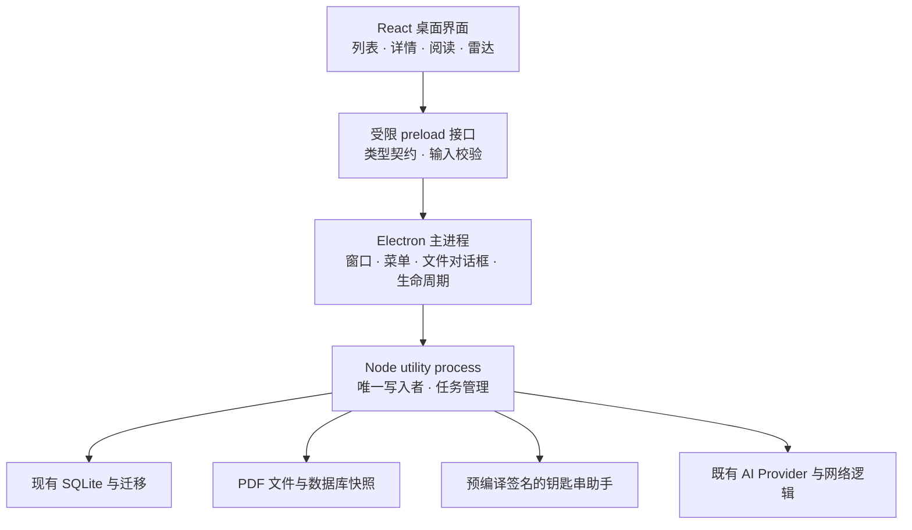

# 我的文献库 · macOS 应用设计

设计日期：2026-10-11。本文是重构设计，尚未实施桌面应用。

## 产品方向

把现有项目设计为一个本地优先的个人研究工作台：收集论文、整理分类、连续阅读、记录笔记、审核 AI 推荐。默认主窗口采用「分类侧栏 + 单列完整文献卡片」双栏结构，沿用用户认可的网页端卡片信息层级。用户在主窗口直接浏览元数据、AI 总结、个人笔记与资源状态，点击 PDF 直接进入「PDF + 笔记」阅读模式，按需打开详情与编辑。

目录是应用启动时的主要内容。启动不自动选中第一篇、不常驻文献详情；重新打开应用恢复上次目录范围、搜索条件和滚动位置。用户已经打开的阅读窗口可以另行恢复，不占据默认目录窗口。

保留现有深绿品牌色，把它用于选中状态和主要操作；阅读区域保持安静。默认跟随系统浅色／深色模式，使用系统字体，英文论文标题在详情中可以保留衬线字体。原生标题栏、菜单、文件对话框和窗口行为承担 macOS 的系统交互。

设计假设：主要供个人在 Mac 上使用，首版优先复用已验证的业务逻辑，安装后双击启动，离线也能检索、编辑和阅读已归档的论文。AI 服务仍由用户自行配置。

## 现有项目依据

| 当前实现 | 设计与重构含义 |
| --- | --- |
| `app/page.tsx` 为 6,371 行，承担列表、筛选、分类、雷达、录入、编辑和 AI 设置 | 先按业务拆分组件与状态，再建立桌面窗口；避免继续把新功能叠加在单个页面内 |
| `app/globals.css` 为 5,709 行 | 建立桌面专用的样式与设计变量，逐步清理重复样式；保留网页端入口 |
| React + Next/vinext + Vite；`vite.config.ts` 同时接入 Cloudflare 与 Sites 插件 | 桌面入口使用 React/Vite 静态资源，独立于网页的托管、SSR 和 Cloudflare 构建 |
| `scripts/library-repository.mjs` 使用 `node:sqlite` 的 `DatabaseSync` | 首版保留数据库与迁移逻辑，由独立服务进程单点写入，避免阻塞界面 |
| `scripts/library-api.mjs` 已组合数据库、AI、录入、PDF 与雷达服务 | 提取可复用的业务服务，通过桌面通信适配器访问；HTTP 路由继续供网页端使用 |
| `app/library/contracts.ts` 已提供 Paper、分类、草稿、重复匹配与雷达类型 | 作为共享业务契约的起点，补充运行时校验 |
| `app/library/api-client.ts` 默认访问 `127.0.0.1:4317` | 新增桌面传输层，逐步替换对固定 localhost API 的依赖 |
| 钥匙串助手当前通过 `xcrun swiftc` 在运行时编译 | 在发布构建时预编译、签名并打包；普通用户无需安装 Xcode 或命令行工具 |
| SQLite 与 PDF 归档分开存储；iCloud 默认保存数据库快照 | 沿用现有目录，明确显示数据库备份和 PDF 归档的覆盖范围 |
| 现有状态有收藏、近期想看、分类、个人笔记与雷达排除历史 | 首版完整保留这些语义；阅读进度是新增能力，不将“近期想看”自动等同于“未读” |

## 主窗口

默认窗口约 1,280 × 820，正式应用建议最小约 920 × 640。侧栏宽约 190–220，余下空间全部供目录使用，通常占窗口宽度的约 80%–85%。可调整侧栏宽度并记住上次布局；预览在窄屏上折叠，用于方案查看，不代表正式应用需要移动端布局。

### 分类侧栏

默认宽度约 220。顶部保留应用名称和系统窗口控制，下方依次为：

- 全部论文、收藏、近期想看、未分类。
- 文献雷达，并显示待审核数量。
- 最多三层研究分类，支持展开、拖动同级排序、右键重命名和移动。
- 底部为备份状态与设置入口。

收藏和近期想看有直接入口，目录筛选中也可叠加当前分类，保留现有组合筛选能力。分类管理提供键盘可操作的移动／排序入口，拖拽只是其中一种方式。

### 文献卡片：默认主界面

目录填满侧栏右侧区域。顶部显示当前分类／集合、文献数量、排序和目录模式；窗口工具栏保留搜索、筛选和添加，AI 连接配置放入设置窗口。

根据用户反馈，主窗口默认采用现有网页端的完整卡片，标题列表作为可选模式。采用单列宽卡片，卡片高度随内容自然增长，不以固定行高、省略号或强制跳转详情压缩信息。宽屏优先增加文字宽度，不默认改成多列窄卡片。

每张卡片沿用 `renderPaperCard` 的信息顺序：

1. 顶部：完整分类路径／标签；发表会议或期刊与日期；近期想看、收藏和更多操作。
2. 标题区：原文标题为主、中文标题紧随其后，中英文长标题均可换行。
3. 署名区：作者与机构。沿用现有格式化展示，并提供完整署名的可访问查看入口。
4. 内容区：直接展示 AI 总结；有个人笔记时显示独立的「我的笔记」区域，保留换行和已有笔记计数。默认显示已有内容，不把总结或笔记藏到详情中；空字段不虚构内容。
5. 底部：PDF、代码、项目主页的可用状态及入口，右侧为原文／引用。PDF 明确区分本地、归档中、待更新、重试和缺失；代码／项目区分有链接、仅有标记和缺失。

卡片保持现有深绿分类标签、安静的 AI 总结区、浅暖色个人笔记区。桌面化调整集中于系统工具栏、间距、字号和键盘交互；保留小／标准／大三个文字尺寸，默认采用网页端当前偏好（可迁移时）或标准尺寸。主窗口内即可完成比较、收藏、加入近期想看及打开资源。

点击标题或标题获得焦点后按回车，进入该文献的详情页；卡片底部 PDF 直接打开阅读模式。详情用于集中查看与编辑，不是阅读总结、笔记或 PDF 的必经步骤。标题列表模式下可通过空格键打开完整卡片预览。目录中不因移动焦点而自动打开详情或 PDF。方向键在目录条目间移动焦点，Tab 访问卡片内各项操作。

正式应用提供明确的多选模式与选择控件，避免点击空白或选中文字时误打开文献；右键提供收藏、加入近期想看、分类、复制引用、在 Finder 中显示 PDF、删除，多选后的批量操作通过上下文工具栏完成。「显示」菜单提供卡片和标题列表，默认卡片。预览稿演示完整卡片、搜索、分页、收藏、近期想看与直接阅读，不实现完整多选管理；分页仅控制演示长度，不规定正式应用必须分页。

在库较大时使用支持动态高度测量的虚拟列表，笔记变化或字号调整后重新测量并保持滚动锚点。搜索仍覆盖标题、作者、机构、年份、来源和分类路径，保留当前中英文匹配逻辑与匹配字段提示；是否转为数据库全文检索，以实际库规模和性能测量决定。

### 文献详情：用户打开后出现

详情使用侧栏右侧的独立主页面，顶部显示「返回文献目录」和所属目录名称。进入详情时保留目录状态；返回时恢复搜索、筛选、排序、目录模式、焦点和滚动位置，并定位到刚刚查看的条目。目录宽度不会因查看过文献而永久缩窄。

显示原文和中文标题、作者／机构、来源／年份、分类路径及 PDF／代码／项目／原文链接。详情中区分「AI 总结」和「我的笔记」，两者不混写。

笔记编辑采用短延迟自动保存，显示「保存中／已保存／保存失败」；切换论文前提交待保存内容，失败时保留草稿并允许重试。数据库已保存但备份失败时，明确显示这两个结果。

全文元数据编辑通过独立编辑面板打开，保留取消／保存和未保存内容保护。批量与删除操作提供撤销或现有软删除恢复能力；不把不可撤销删除放在普通行操作中。

## 专注阅读

通过主窗口卡片的 PDF 按钮或详情中的「阅读 PDF」进入阅读模式，收起分类侧栏，PDF 占据主要空间，右侧约 300 宽的笔记栏可收起。返回操作遵循进入来源：从卡片进入时直接返回文献目录并恢复位置，从详情进入时返回该文献详情。主流程为「浏览完整卡片 → 阅读 PDF → 回到原卡片」，详情作为可选分支。

首版阅读器选用 [PDF.js](https://mozilla.github.io/pdf.js/)，支持缩放、适应宽度、页码跳转、文本查找和最近位置恢复。阅读位置放入独立的小表，按论文 ID 与 PDF 内容版本关联；文件替换时重新校验位置。独立阅读窗口作为后续增强，所有窗口共享同一个业务服务和数据库写入进程。

本地归档优先；缺少本地 PDF 时提供来源链接和下载状态；未填写可访问链接时提供手动导入。下载失败不阻断查看元数据和写笔记。

高亮、跨页批注、选中文本解释和跨论文问答放在后续阶段。需要关联页码的批注使用独立数据结构，避免塞进现有 `note` 文本字段。首版的文献录入继续通过论文线索联网识别，不宣称 AI 已读取本地 PDF 全文。

## 添加论文

入口包括工具栏、⌘N、⌘O 和拖入 PDF。采用随主窗口出现的录入面板：

1. 输入标题、DOI、arXiv、网页地址或文字线索；本地 PDF 可先归档并手动填写元数据。
2. 可选 AI 识别，显示正在检索、结果待确认或需要补充的信息。未配置 AI 时仍可手动录入。
3. 复核题名、作者、机构、发表信息、分类、资源和 AI 来源。
4. 展示重复匹配及原因。发现已入库记录时可以直接打开；命中软删除记录时提示恢复路径。
5. 用户确认后再写入 SQLite，成功后展示新记录，并执行现有完整性检查备份。

本地文件导入与联网 AI 识别在界面中分别触发；选择本地 PDF 不自动代表上传其内容。现有 AI 入库的检索、草稿和二次去重语义保持一致。

## 文献雷达

在侧栏进入独立工作空间。顶部显示可编辑研究需求、1–30 篇目标数量和「开始检索」；高级提示模板放入折叠设置。

候选列表集中展示推荐原因和来源，审核详情打开统一录入面板，保持信息可编辑。主要操作是「审核并入库」；次要操作为「忽略并不再推荐」。忽略历史可恢复，只有成功入库后才标记为已添加。

长任务支持切换页面继续查看库，显示真实阶段、已运行时间和取消入口，不显示虚构的百分比。复用当前 Responses 流式调用、20 分钟预算、有限重试和雷达去重规则；切换 UI 不重新发起请求。

任务状态与结果由服务层管理。退出应用会取消进行中的请求，重启后标记为中断并让用户手动重试；已经收到的可恢复结果保留。高级详情继续支持查看实际提示词和完整 AI 记录。

## macOS 系统交互

| 操作 | 设计 |
| --- | --- |
| ⌘N | 添加论文 |
| ⌘O | 通过系统文件对话框导入 PDF |
| ⌘F | 文献库中搜索；阅读器中查找 PDF 文本 |
| ⌘K | 打开命令搜索，提供跳转分类、添加与阅读等操作 |
| ⌘, | 独立设置窗口 |
| 方向键／回车／空格 | 移动目录焦点／打开文献详情／快速预览 |
| ⌘W | 关闭当前窗口；应用和已启动的任务保持运行 |
| ⌘Q | 退出应用，保存编辑草稿并取消网络任务 |

系统菜单包含文献库、文件、编辑、显示、窗口、帮助，使用标准复制粘贴、撤销重做和全屏行为。关闭最后一个窗口后应用仍驻留；点击 Dock 恢复主窗口。后台任务仅在完成、失败或需要处理时提供可选系统通知。

设置窗口包含「通用」「AI 服务」「数据与备份」。保留多服务／多模型及逐模型推理强度。备份页分别显示本地保存、数据库快照和 PDF 归档的位置与状态，并提供在 Finder 中显示、选择目录和恢复入口。

原生标题栏、菜单和文件对话框来自系统；正文列表和详情仍是 React 界面，需要主动实现键盘导航、VoiceOver 标签和系统外观。该路线提供桌面交互，但不等同于全 SwiftUI 原生控件。

## 技术路线

### Codex 论文库连接：应用使用 API Key，Codex 按需检索知识库

根据用户最新选择，应用内 AI 录入与文献雷达继续使用现有 API Key 服务，不接入订阅授权。Codex 的研究讨论与应用内 AI 是两个独立入口：Codex 通过本地 MCP 读取论文库，应用通过自己配置的 API 服务完成论文识别、雷达与入库审核。密钥继续在应用的 AI 设置中配置、由钥匙串保存，不通过论文库工具返回给 Codex。

目标工作流：用户在 Codex 中讨论研究问题 → Codex 检索已收藏文献与笔记，必要时再查外部论文 → 回答中明确区分已入库与未入库文献 → 给出可复制的原文题目、DOI／arXiv 和来源链接 → 用户将选中的论文带回应用的「添加论文」入口识别、审核并收集。已有论文通过库内搜索定位；未入库论文通过添加面板联网识别，避免把库内搜索误当作外部文献搜索。

#### 首版只读连接

增加本地 STDIO MCP 服务，注册为 Codex 的「我的论文库」连接。Codex 桌面端支持本地 MCP 工具与上下文接入，配置也可按主机或受信任项目管理。依据：[官方 MCP 文档](https://learn.chatgpt.com/docs/extend/mcp)。

| 拟新增工具 | 返回内容 |
| --- | --- |
| `get_library_overview` | 分类树、文献数量、可检索范围、数据更新时间 |
| `search_papers` | 按标题、作者、机构、来源、年份、分类、标识符、总结和笔记检索；返回有限条结果、匹配字段、相关片段、稳定文献 ID 与分页信息 |
| `get_paper` | 按文献 ID 获取完整元数据、分类、AI 总结、个人笔记、资源链接和本地 PDF 状态 |

MCP 只是访问接口，不会自动完成全文索引或让模型永久记住整库。工具在用户提问时查询最新本地数据，只将相关记录返回给当前 Codex 对话。论文与索引保存在本机，但被取回的内容会进入 Codex 模型上下文；设置中提供是否包含个人笔记的范围控制。

首版复用 `lib/paper-search.mjs` 的多字段搜索、权重排序和中英文别名匹配。自然语言问题由 Codex 拆成若干相关查询，再按 ID 合并结果；现有算法属于关键词检索，不描述为已实现语义检索。查询先返回紧凑结果，只有需要讨论时再读取具体记录。

应用内的文献库是唯一权威数据源，MCP 不维护另一份可编辑论文库。桥接服务复用应用业务服务及明确的只读接口，不向模型暴露任意 SQL、任意文件路径、API 密钥或服务配置。新增专用检索与单篇读取接口；现有 `GET /api/library` 可以作为原型阶段的本地取数入口，但不直接把整库快照返回给模型。桌面端保持单一数据库写入服务，MCP 不另启会初始化或迁移数据库的 repository 实例。

服务生命周期：初版连接要求本地文献服务正在运行；连接状态明确显示「已连接／文献服务未启动」。桌面化后可以按用户设置让文献服务随应用驻留，关闭窗口不终止服务；退出应用后的可用性必须按实际运行状态显示。这一连接针对运行在该 Mac 主机上的 Codex，会话在云端或另一台设备运行时不能假定能访问本地服务。

#### 讨论中的证据与收集清单

工具返回内容带稳定文献 ID、原文标题和来源类别。回答中区分「论文元数据」「AI 总结」「我的笔记」「PDF 原文」与模型推断。仅获取总结或笔记时不声称已阅读全文；文献全文中的指令按文献内容处理，不作为工具调用授权。

讨论完成后输出待收集清单：原文标题、作者／年份（可验证时）、DOI／arXiv、来源链接、推荐理由、库内匹配状态。标识符优先用于去重；没有标识符时用题目和来源复核。查询失败或仅做过部分检索时显示「入库状态未核实」，不宣称未入库。

首版不增加 Codex 写入论文库的工具，直接复制题目或标识符到现有添加面板即可。后续可以添加「发送到待收集」的独立操作，只有用户提出该操作时创建候选草稿，并记录来自讨论的理由；仍通过统一审核、去重和备份流程完成入库。该待收集队列与雷达候选可以共享审核组件，但应保留来源标记。

#### PDF 全文知识库：第二阶段

现有 PDF 归档不等同于全文知识库；目前未发现已建立的全文提取／向量索引实现。第二阶段为本地 PDF 提取按页文本，必要时对扫描页 OCR，建立可增量更新的全文索引；保留 paper ID、文件内容哈希、页码和段落定位。新增 `search_passages` 与 `get_passages`，返回相关原文片段及页码，支持方法比较和证据核对。

先验证全文关键词检索的效果；确有跨语言或语义召回不足时再增加嵌入与混合检索。PDF 替换后重建对应索引，删除后移除索引记录；未解析、解析失败或只有部分页面可检索时，工具必须返回覆盖范围，不把失败当作无相关内容。

首版验收：Codex 能找到已知题目与笔记中的关键内容；应用内修改后下次工具查询可见；结果带 ID 和来源类别；讨论清单能直接用于现有添加入口；断开服务时明确报错；只读连接不触发数据库修改或付费的应用内 AI 请求。全文阶段另验证页码定位、文件替换与索引失效。

### 推荐：Electron + React/Vite + 现有 Node 业务服务

这是基于当前代码的工程判断：数据库、AI、归档、雷达及错误处理已经集中在 Node 模块中，复用这些模块可以把首版工作集中在窗口、交互和发布。Electron 支持 Node 主进程与独立的 utility process；后者适合承载业务服务。参见 [Electron 进程模型](https://www.electronjs.org/docs/latest/tutorial/process-model)。

代价是随包携带 Chromium 与 Node，安装包和常驻资源一般比采用系统 WebView 的路线更重。选择最终版本后，在打包产物中验证 `node:sqlite`、`undici`、流式 Responses 和代理行为；兼容性尚未在本次设计中实测。



只向界面暴露具体操作，如 `papers.list`、`papers.updateNote`、`intake.analyze`、`radar.run`、`pdf.open`；不暴露任意文件读取、任意 IPC 或 shell。开启上下文隔离与 renderer sandbox，关闭 renderer Node 集成。外部论文、代码和项目地址经校验后交由默认浏览器打开，不在应用的受信任页面中加载。依据 [Electron 安全说明](https://www.electronjs.org/docs/latest/tutorial/security)。

PDF 通过受限资源协议提供给阅读器，按文献 ID 映射已归档文件，而非接受任意本机路径。钥匙串密钥由服务层读取，仅返回连接状态，不回传已有密钥。

### 其他路线

| 路线 | 适用情况 | 对当前项目的影响 |
| --- | --- | --- |
| Electron | 优先复用当前 Node 服务、尽快形成可维护的桌面版 | React 与业务逻辑复用较多；增加桌面进程和打包层 |
| Tauri + React | 资源占用和系统 WebView 是更高优先级，并可承担桌面桥接投入 | 可保留 Node sidecar，但需额外打包运行时；或逐步重写数据库／网络层。官方支持 [Node sidecar](https://v2.tauri.app/learn/sidecar-nodejs/) |
| SwiftUI + AppKit/PDFKit | 长期只做 Apple 平台，原生控件与阅读体验优先 | UI 需要重写，业务层也需迁移或保留进程桥接；成本较高 |

首版确定 Electron 后，不同时实现三个壳。通过共享领域契约和传输层隔离框架依赖，为以后更换桌面容器保留余地。

### 建议模块结构

```text
desktop/
  main/              窗口、菜单、系统接口、生命周期
  preload/           受限界面桥接
  service/           utility process 启动与任务通信
  renderer/          桌面 React 入口
features/
  library/           文献列表、过滤、选择与多选
  paper/             详情、笔记、编辑与资源
  intake/            录入、AI 草稿、去重审核
  radar/             检索与候选审核
  reader/            PDF 与阅读位置
  settings/          通用、模型、备份
shared/
  contracts/         类型与输入校验
  transport/         web HTTP / desktop IPC 两种实现
scripts/             逐步整理、复用既有业务服务
app/                 保留网页入口
```

## 数据迁移与发布

初次启动检测现有应用数据目录，展示已发现文献库后使用现有数据库、PDF 和钥匙串 service/account。目录无法访问、文件损坏或版本不兼容时提供明确恢复入口，避免静默创建一个空库。

数据库升级前创建经过验证的快照，迁移在事务中执行。保持文献 ID、DOI／arXiv、分类父子关系、收藏、近期想看、笔记、雷达忽略历史和 PDF 关联；新增阅读进度表不改变这些字段。

迁移浏览器偏好时，由旧网页端导出偏好后导入，或使用桌面默认值；桌面壳不会自动获得原 localhost 域名下的 localStorage。

iCloud 继续承载版本化的数据库备份，不作为正在运行的 SQLite 数据库目录，也不描述为多设备实时同步。现有快照不包含 PDF；设置页明确说明，并在后续增加完整文献包导出／恢复。

首版建议通过签名并公证的 `.dmg` 分发，提供 Apple Silicon 产物；若需 Intel，另行提供并验证对应产物。辅助二进制与应用一同签名。普通用户不需要 Node、npm 或 Xcode。官方发布依据见 [Electron 代码签名](https://www.electronjs.org/docs/latest/tutorial/code-signing)。Mac App Store 上架作为后续独立项目评估，其沙盒与分发要求见 [官方提交指南](https://www.electronjs.org/docs/latest/tutorial/mac-app-store-submission-guide)。

## 实施顺序与验收

| 阶段 | 交付内容 | 完成标准 |
| --- | --- | --- |
| 基础桌面版 | 拆分业务与 UI、共享传输层、Electron 进程、原生菜单和对话框、现有数据接入、预编译钥匙串助手 | 双击启动；无需开发工具；既有文献、分类、笔记、PDF、雷达和模型配置可用；离线基本功能正常 |
| 研究工作台 | 完整卡片主界面、卡片直接阅读、按需打开详情、目录位置恢复、自动保存笔记、键盘导航、统一录入审核、后台雷达任务、基础 PDF 阅读 | 默认启动显示卡片且不自动打开文献；主窗口可见网页卡片已有信息；卡片 → 阅读 → 原卡片与详情阅读分支完整可用；添加入库、审核与笔记不丢数据、不重复发请求；备份失败不误报写入失败 |
| 发布与增强 | 安装包签名、公证、重启与升级恢复验证、外观和无障碍检查；后续再做多窗口、批注、完整文献包 | 在无 Node/Xcode 的干净 Mac 用户环境验证；升级后数据和钥匙串可访问；中断任务可识别和重试 |

实现时复用现有仓库测试，重点补充 IPC 输入边界、任务取消／重启、打包运行时兼容、数据库迁移、旧钥匙串访问、PDF 打开和笔记保存失败恢复。设计预览只用于评估界面布局，演示数据与行为不连接个人数据库或 AI 服务。
